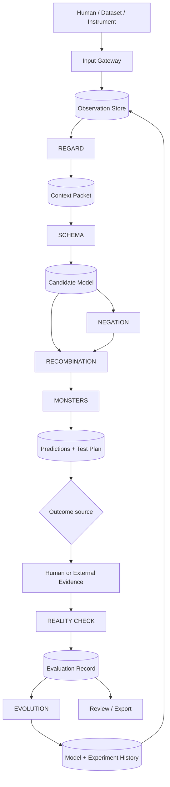
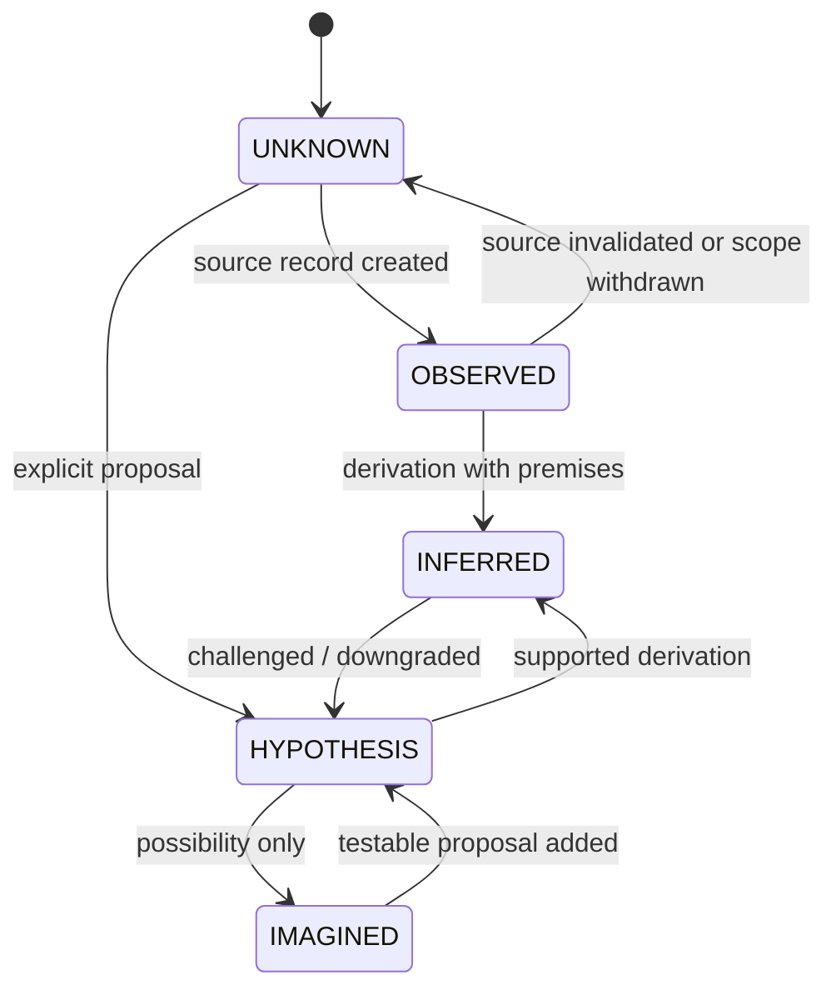
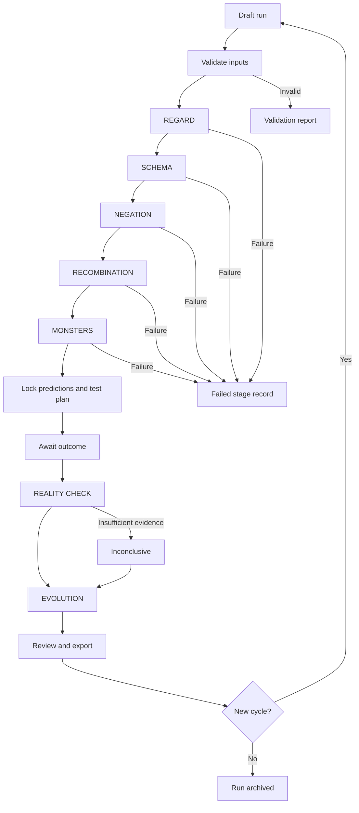

# Reality Regard: Build Plan & System Schematic

**Document type:** Implementation plan  
**Status:** Proposed, not yet implemented  
**Branch:** `experiment/reality-regard`  
**Scope:** First executable research prototype, isolated from the Android application and existing Reality Loom runtime.

## 0. Build objective

Deliver a small, repeatable multi-agent experiment that can:

1. ingest observations with provenance;
2. construct a candidate model;
3. generate rival explanations and adversarial tests;
4. make predictions before outcomes are known;
5. compare predictions with external or human-supplied evidence;
6. preserve the complete reasoning and experiment history;
7. produce a next experiment without silently converting agreement into truth.

**Definition of done:** one end-to-end run creates inspectable, versioned artifacts; a reviewer can trace every factual claim to its support, distinguish all five epistemic states, reproduce the run configuration, and see how a contradictory result changes the next model.

The prototype is a research instrument, not a general intelligence claim and not a validated simulator of the universe.

---

## 1. System map



### Trust boundaries

- **Input boundary:** imported text, files and datasets are untrusted inputs. Preserve their source and ingestion metadata.
- **Agent boundary:** agents receive explicit context packets and return structured proposals. They do not directly mutate the canonical store.
- **Validation boundary:** schemas, IDs, references and permitted state transitions are checked by deterministic code.
- **Reality boundary:** outcomes must come from a declared human, instrument or external dataset source. A model-generated answer cannot validate that same model.
- **Persistence boundary:** only the orchestrator commits validated artifacts. Every write is append-oriented or versioned.

---

## 2. Runtime architecture

Keep the first prototype as a standalone TypeScript package or small web application. Do not couple it to Android, WebView, Three.js or the Reality Loom physics loop.

| Layer | Responsibility | First implementation |
|---|---|---|
| Workbench UI | Create runs, inspect artifacts, compare versions | Simple local web UI; CLI acceptable for first vertical slice |
| Orchestrator | Run stages, manage state, retries and cancellation | Deterministic sequential pipeline |
| Agent adapters | Convert typed context into agent requests and validate responses | Shared interface; deterministic mock adapter first |
| Domain agents | REGARD through EVOLUTION role behavior | Separate prompts/functions per role |
| Domain model | Observation, Claim, Model, Prediction, Experiment | Typed schemas with runtime validation |
| Evidence ledger | Provenance, immutable observations, artifact links | Local JSON/SQLite persistence |
| Evaluation | Compare predictions to outcome and baselines | Deterministic scoring and explicit human review |
| Export | Reproduce and share a run | JSON bundle plus Markdown report |

**Design rule:** the LLM proposes; the domain layer validates; the ledger records. Never let free-form agent output become canonical state without validation.

### Suggested repository layout

```text
docs/
  reality-regard/
    README.md                 # Research protocol
    PLANNING.md               # This system schematic
    DATA_MODEL.md             # Canonical entities and schemas
    EVALUATION.md             # Metrics, baselines and test protocol
    decisions/
      0001-standalone-prototype.md

experiments/
  reality-regard/
    package.json
    src/
      domain/
        observation.ts
        claim.ts
        model.ts
        experiment.ts
        epistemic-status.ts
      orchestrator/
        run-cycle.ts
        stage-contract.ts
        state-machine.ts
      agents/
        regard.ts
        schema.ts
        negation.ts
        recombination.ts
        monsters.ts
        reality-check.ts
        evolution.ts
      adapters/
        agent-adapter.ts
        mock-adapter.ts
      persistence/
        ledger.ts
        json-ledger.ts
      evaluation/
        score-prediction.ts
        compare-baseline.ts
      export/
        export-run.ts
    tests/
      unit/
      integration/
      fixtures/
    examples/
      falling-object/
```

This is a target layout, not a claim that these files already exist. Keep the module independently runnable and easy to remove or replace.

---

## 3. Canonical data flow

All agent stages exchange typed packets. Each packet includes:

- `run_id`, `stage_id`, `agent_role`, `created_at`
- `input_artifact_ids`
- `output_artifact_ids`
- `agent_version`, `prompt_version`, `model_identifier` when applicable
- `warnings`, `validation_errors`

### Core entities

| Entity | Purpose | Mutability |
|---|---|---|
| Observation | Source-grounded record of what was encountered | Immutable; corrections create a superseding record |
| Claim | Atomic proposition with epistemic status and provenance | Versioned |
| Entity | Named or provisional object in a model | Versioned |
| Relationship | Typed connection between entities | Versioned |
| Model | Coherent, revisable collection of claims and relations | Immutable snapshot |
| Prediction | Preregistered expected outcome and conditions | Immutable after test begins |
| Test | Procedure for evaluating a prediction | Versioned before execution; locked at execution |
| Outcome | Observed result and evidence references | Immutable |
| Experiment | Links question, model, predictions, tests and outcomes | Append-only history |
| AgentRun | Records one agent execution and its exact inputs/outputs | Immutable |

### Epistemic state machine



This diagram is illustrative, not a rule that every claim must traverse every state. The implementation must retain status history and reason for each transition. No transition may be caused solely by the number of agents endorsing a claim.

### Claim provenance invariant

Every `OBSERVED` claim must reference at least one observation. Every `INFERRED` claim must reference premises and a derivation. A `HYPOTHESIS` must state what evidence could support or weaken it. An `IMAGINED` claim must remain visibly speculative. `UNKNOWN` records a gap, not a failure.

---

## 4. Agent contracts

| Stage | Reads | Must produce | Must not do |
|---|---|---|---|
| REGARD | Raw input and source metadata | Observation candidates, entity candidates, relation candidates, ambiguities | Invent source details or mix explanation into raw observation |
| SCHEMA | Validated observations and prior relevant claims | Model snapshot, assumptions, gaps, predictions | Hide assumptions or cite unsupported facts as observed |
| NEGATION | Model, observations, claim graph | Contradictions, missing variables, rival explanations, discriminating tests | Merely say “could be wrong” without a concrete challenge |
| RECOMBINATION | Model plus negation results | At least one meaningfully different candidate, lineage and changed assumptions | Merge incompatible claims without preserving conflict |
| MONSTERS | Candidate models, test constraints | Adversarial scenarios, edge cases, falsifiable failure conditions | Treat imaginative attacks as real-world evidence |
| REALITY CHECK | Locked predictions, procedure, outcome evidence | Prediction/outcome comparison, evidence quality, limitations | Accept model-generated outcomes as independent validation |
| EVOLUTION | Full run ledger and evaluation | Keep/revise/reject decisions, next experiment, version links | Delete failures or promote a model on consensus |

Every stage returns a structured result plus a short human-readable explanation. Structured results are authoritative for orchestration; prose is explanatory only.

---

## 5. Orchestration protocol

A run follows explicit states:



### Execution rules

1. Validate input and create a run ID before invoking agents.
2. Persist each stage input, output, version and validation result.
3. Retry only transient adapter failures, with a bounded retry count.
4. Never retry by silently changing the prompt or input. A changed attempt gets a new attempt record.
5. Lock predictions, success criteria and test procedure before outcome collection.
6. If no suitable outcome source exists, mark the run **AWAITING_EVIDENCE** or **INCONCLUSIVE**. Do not manufacture a result.
7. Allow a human to pause, cancel, inspect and resume a run.
8. A failed stage is preserved with its error category and partial artifacts.

---

## 6. First experiment: falling object

Use a narrow, measurable domain to test the machinery before attempting broad claims about existence.

**Question:** Under specified conditions, how does an object's drop time vary with drop height?

**Inputs:** a small, cited dataset or manually recorded trials, including height, measured time, units, instrument/method, and conditions. Start with an explicitly simplified setup; document air resistance and measurement error as limitations.

**Competing models:**
- M0: constant-time baseline or simple empirical baseline.
- M1: a height-dependent model.
- M2: an alternative model proposed by NEGATION or RECOMBINATION.

Do not hard-code a desired winner. The data and preregistered test determine comparative performance.

**Prediction protocol:** reserve test observations before fitting candidate models. Record the metric and baseline before evaluation. Avoid using the test set to tune the model.

**Reality Check:** compare predictions with held-out measurements; report error, sample size, uncertainty and limitations. If the dataset is too small or unsuitable, label the result inconclusive.

**Why this experiment:** it is easy to understand, has measurable variables, supports competing models, and exposes the difference between a plausible explanation and predictive performance.

---

## 7. Evaluation gates

| Gate | Required evidence to proceed |
|---|---|
| G0: Contract | Domain schemas validate; epistemic labels and provenance are enforced |
| G1: Single cycle | All seven roles run in sequence using mock adapters; artifacts persist |
| G2: Adversarial value | NEGATION/MONSTERS produce at least one concrete, reviewable challenge |
| G3: Reality test | Prediction is locked before outcome; comparison uses external or human evidence |
| G4: Evolution | Contradictory evidence changes or explicitly preserves the model with a reason |
| G5: Reproduction | A second operator can load the run bundle and reconstruct inputs, versions and results |

A gate can fail. Failure creates a work item; it does not get rounded up to success.

### Metrics

- Claim traceability rate
- Unsupported-observation violation count (target: zero)
- Prediction error against a declared baseline
- Number and severity of unique counterexamples found
- Fraction of challenges resolved, unresolved or shown irrelevant
- Correct handling of contradictory evidence
- Reproducibility of run configuration and artifact graph
- Cost, latency and failure rate per stage

Report raw counts and denominators. Do not collapse all metrics into a single “intelligence score” during the prototype.

---

## 8. Test strategy

**Unit tests**
- epistemic status validation and transition history;
- provenance requirements for each claim type;
- stable ID and reference validation;
- immutable observations and locked predictions;
- model lineage and version creation;
- scoring and baseline calculations.

**Contract tests**
- each agent response matches its output schema;
- unknown fields and malformed references are rejected or quarantined;
- agent prose cannot override structured fields;
- mock and live adapters obey the same interface.

**Integration tests**
- full seven-stage mock run;
- missing evidence yields inconclusive status;
- contradictory outcome reaches EVOLUTION;
- retry creates a distinct attempt record;
- export/import preserves the artifact graph.

**Adversarial fixtures**
- two observations with conflicting sources;
- ambiguous entity references;
- missing units;
- duplicated observations;
- one agent falsely labels an inference as observed;
- consensus around a deliberately false hypothesis;
- evidence that invalidates a previous observation's scope.

---

## 9. Milestones and work breakdown

### M0 — Foundations
- [ ] Create standalone package and test runner.
- [ ] Define runtime schemas and epistemic status enum.
- [ ] Implement append-oriented local ledger.
- [ ] Add architecture decision record for standalone boundary.

**Exit:** valid artifacts can be stored and reloaded with provenance intact.

### M1 — One complete mock cycle
- [ ] Define shared agent adapter contract.
- [ ] Implement deterministic mock agents for all seven roles.
- [ ] Implement sequential orchestrator and run state machine.
- [ ] Export a complete run bundle.

**Exit:** automated integration test completes one cycle without an LLM dependency.

### M2 — Challenge and prediction discipline
- [ ] Add claim graph and contradiction references.
- [ ] Add rival-model generation and adversarial fixtures.
- [ ] Lock predictions and test criteria before outcome.
- [ ] Add independent outcome ingestion.

**Exit:** a deliberately false consensus case is rejected or left unvalidated, and a challenge is traceable.

### M3 — Reality Check and Evolution
- [ ] Implement baseline comparison and evaluation report.
- [ ] Add inconclusive and contradicted outcomes.
- [ ] Implement versioned keep/revise/reject decisions.
- [ ] Generate next-experiment proposals.

**Exit:** contradictory evidence produces a visible model revision or a reasoned decision not to revise.

### M4 — Human workbench
- [ ] Build run creation and observation entry.
- [ ] Show agent artifacts and claim provenance.
- [ ] Show model diffs and unresolved contradictions.
- [ ] Add outcome review and export.

**Exit:** a human can inspect and guide a complete run without reading raw logs.

### M5 — Controlled live-agent trial
- [ ] Add one live provider adapter behind the shared interface.
- [ ] Capture provider/model/prompt versions and token/cost metadata where available.
- [ ] Compare live outputs with mock baseline and human-reviewed fixtures.
- [ ] Add rate limits, timeout handling and safe failure states.

**Exit:** live agents improve a measured capability without weakening validation or provenance.

---

## 10. Initial GitHub issue map

Create separate issues so implementation can be tracked independently:

1. **[M0] Define Reality Regard domain schemas and epistemic invariants**
2. **[M0] Implement append-oriented experiment ledger**
3. **[M1] Build shared agent adapter and deterministic mock agents**
4. **[M1] Implement sequential seven-stage orchestrator**
5. **[M2] Add claim graph, negation and adversarial fixtures**
6. **[M2] Lock predictions and ingest independent outcomes**
7. **[M3] Implement Reality Check metrics and baseline comparison**
8. **[M3] Implement Evolution decisions and experiment lineage**
9. **[M4] Build human inspection workbench**
10. **[M5] Add controlled live-agent adapter and cost telemetry**

Do not start M5 before G0–G4 pass.

---

## 11. Risks and containment

| Risk | Failure mode | Containment |
|---|---|---|
| Consensus laundering | Repeated agreement looks like evidence | Track shared ancestry; require independent outcomes |
| Epistemic drift | Inference becomes “observed” after multiple transformations | Enforce claim-level provenance and status history |
| Circular evaluation | Model generates its own confirming evidence | Separate outcome source and evaluator |
| Prompt monoculture | Agents repeat one model's assumptions | Blind independent passes and explicit rival agents |
| Metric gaming | Agents optimize a score rather than model quality | Multiple metrics, held-out tests and human review |
| Premature complexity | Building a large agent platform before one cycle works | Mock-first vertical slice and hard gates |
| Unreproducible runs | Provider changes make old results impossible to interpret | Version prompts, adapters, inputs and model identifiers |
| Scope contamination | Prototype destabilizes Reality Loom / Android app | Standalone package and isolated branch |

---

## 12. Decisions to keep explicit

| Decision | Initial choice | Revisit when |
|---|---|---|
| Runtime | Standalone TypeScript | A measured need for another runtime appears |
| Persistence | Local JSON ledger first; SQLite if query needs justify it | Run volume or graph queries become cumbersome |
| Orchestration | Sequential and deterministic | A measured bottleneck justifies parallel stages |
| Agent implementation | Mock adapters before live models | G0 and G1 pass |
| Outcome authority | Human/instrument/external dataset | Domain-specific evidence policy is written |
| UI | CLI or minimal local workbench first | Core artifact flow stabilizes |
| Deployment | Local only | Security, privacy and operational requirements are defined |

## 13. Immediate next action

Implement **M0 only**: domain schemas, epistemic invariants, and the append-oriented ledger. Add tests that deliberately attempt to promote an unsupported inference to OBSERVED and verify that the write is rejected.

That is the first guardrail worth making executable.
